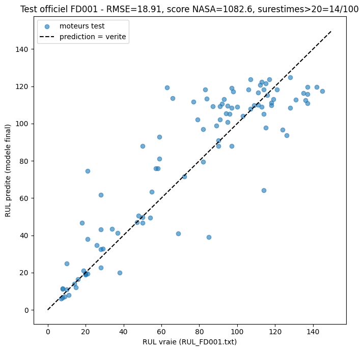
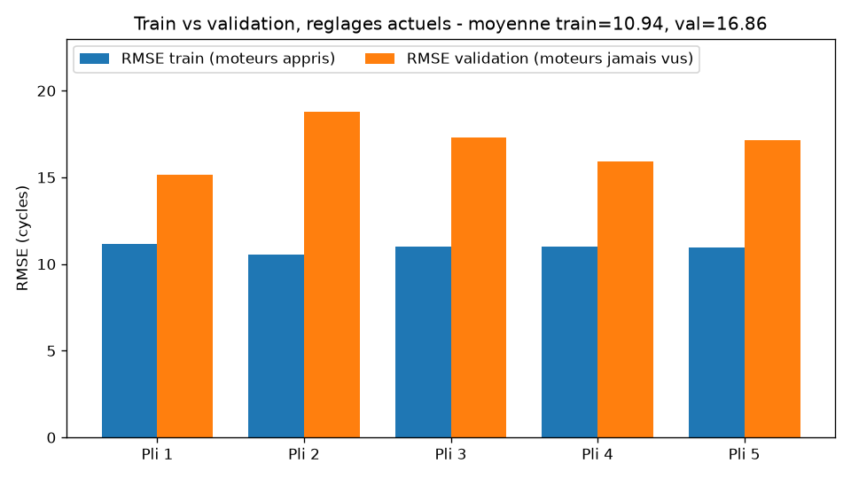
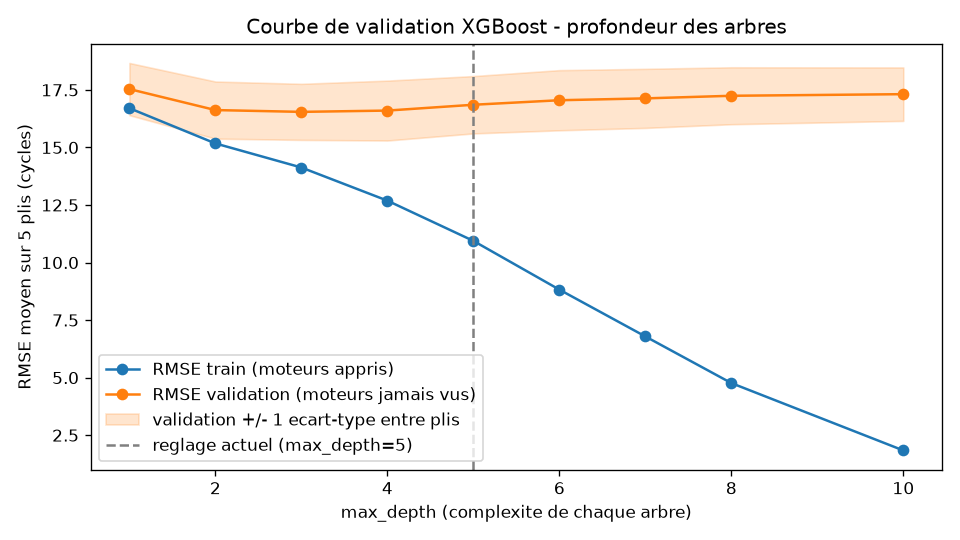
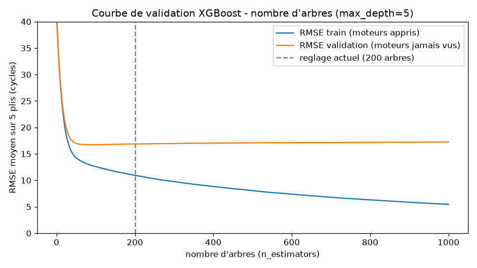
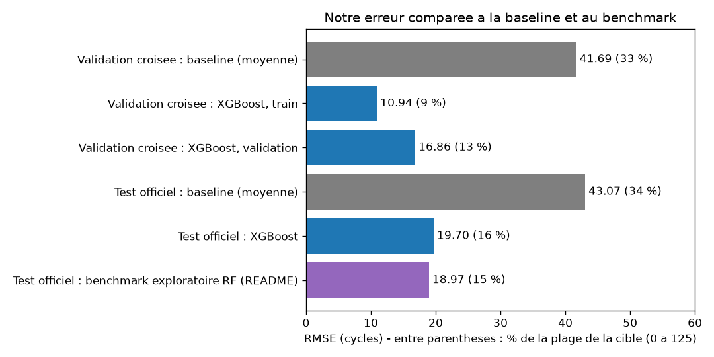

# Phase 3 — Modélisation baseline (XGBoost, FD001)

**Statut** : validée.

## Contexte

Avant cette phase, aucun chiffre de performance n'était reproductible dans le repo : l'ancien notebook
exploratoire produisant RMSE/score NASA a été supprimé ([ADR-0006](decisions/0006-suppression-baseline-exploratoire.md)).
Cette phase entraîne un premier modèle réel, en réutilisant les pipelines validés des Phases 1 et 2
(regroupés dans [`src/preprocessing.py`](../src/preprocessing.py)), et l'évalue sur le jeu de test officiel.
Notebook complet : [`notebooks/03_modelisation.ipynb`](../notebooks/03_modelisation.ipynb).

## Méthode et résultats

### 1. Features : fenêtre glissante et numéro de cycle

Pour chaque capteur, deux colonnes sont ajoutées : la moyenne et l'écart-type calculés sur les 5 derniers
cycles (moteur par moteur, causal). Elles capturent la tendance et la dispersion récentes du signal —
en particulier la hausse de dispersion en fin de vie déjà démontrée en Phase 2. Cela donne 45 features
(15 capteurs lissés + 15 moyennes glissantes + 15 écarts-types glissants).

À ces 45 colonnes s'ajoute `time_cycles` (le numéro du cycle en cours), soit **46 features** au total —
ajouté après le test d'ablation de la section 5. `unit_number` reste exclu : c'est une étiquette de moteur,
pas une mesure, et les moteurs du test sont d'autres moteurs que ceux du train. `time_cycles` n'est pas
normalisé (XGBoost est insensible à l'échelle ; il faudra le normaliser pour un LSTM ou un CNN 1D).

Au tout premier cycle de chaque moteur, l'écart-type glissant n'existe pas mathématiquement (une seule
valeur disponible) : les 1500 `NaN` résultants (100 moteurs × 15 capteurs) sont remplacés par 0.

### 2. Score NASA (Saxena et al., 2008)

Implémenté et vérifié par un cas de calcul simple avant utilisation : une surestimation de 20 cycles coûte
`exp(20/10)-1 ≈ 6.39`, une sous-estimation de 20 cycles coûte `exp(20/13)-1 ≈ 3.66` —
l'asymétrie voulue (surestimer, donc risquer une panne en vol, coûte plus cher) est confirmée dans le code.

### 3. Validation croisée par moteur (GroupKFold)

Un même moteur ne peut jamais apparaître à la fois dans le sous-ensemble d'entraînement et de validation
d'un pli : sinon le modèle risquerait de reconnaître partiellement ce moteur plutôt que d'apprendre un
patron général de dégradation, ce qui fausserait l'estimation de performance. Vérifié explicitement à
chaque pli (intersection vide entre les deux ensembles de moteurs).

`GroupKFold(n_splits=5, shuffle=True, random_state=42)` : par défaut, `GroupKFold` répartit les moteurs
entre les plis selon leur ordre d'apparition dans le fichier, pas au hasard — un choix qui pourrait
biaiser chaque pli si cet ordre correspondait à autre chose qu'un simple ordre de simulation. Vérifié
(à l'époque avec 45 features) : avec `shuffle=True`, le RMSE moyen ne change presque pas (18.61 sans
mélange vs 18.64 avec) — donc pas de biais caché ici — mais le mélange (avec une graine fixe pour rester
reproductible) est conservé pour ne plus jamais avoir à supposer que l'ordre du fichier n'a pas
d'importance.

Résultats avec les 46 features :

| Pli | RMSE validation | Score NASA validation | RMSE train (ajouté le 2026-10-21, voir section 6) |
|---|---|---|---|
| 1 | 15.17 | 19 024.1 | 11.17 |
| 2 | 18.79 | 24 855.2 | 10.56 |
| 3 | 17.29 | 40 402.5 | 11.03 |
| 4 | 15.90 | 30 488.2 | 11.00 |
| 5 | 17.13 | 33 876.7 | 10.94 |
| **Moyenne** | **16.86** | **29 729.3** | **10.94** |

**Note de reproductibilité** : ces chiffres de validation croisée peuvent varier légèrement d'une
exécution à l'autre (observé avec 45 features : 18.17 puis 18.61 sur deux runs successifs, avant l'ajout
du `shuffle`), malgré `random_state=42` fixé sur `XGBRegressor`. XGBoost parallélise la construction des
arbres sur plusieurs cœurs, et l'ordre des opérations flottantes en parallèle n'est pas garanti identique
d'un environnement à l'autre — un phénomène connu, pas un bug du code. Avec 45 features, le modèle final et
son évaluation sur le test officiel sont restés strictement identiques sur trois runs.

### 4. Évaluation sur le jeu de test officiel

Un modèle final (mêmes hyperparamètres) est entraîné sur les 100 moteurs d'entraînement, puis évalué sur
`test_FD001.txt` (trajectoires tronquées avant la panne) comparé à `RUL_FD001.txt` (RUL vraie fournie
séparément pour le dernier cycle de chaque moteur test). Le même `scaler` que le train est appliqué en
`transform` seul (jamais réajusté sur le test), pour éviter toute fuite d'information.

Résultats du modèle à 46 features (celui du notebook actuel) :

- **RMSE test = 19.70**
- **Score NASA test = 852.9**
- **Moteurs surestimés de plus de 20 cycles : 9/100**

Pour mémoire, le même modèle à 45 features (sans `time_cycles`), tel qu'exécuté par le notebook au commit
`a97a82d`, donnait : RMSE 18.91, score NASA 1 082.6, 14/100 surestimés.

| Test officiel | 45 features (`a97a82d`) | 46 features (actuel) |
|---|---|---|
| RMSE | 18.91 | 19.70 |
| Score NASA | 1 082.6 | 852.9 |
| Surestimés de plus de 20 cycles | 14/100 | 9/100 |

Le résultat est **mixte** : le RMSE du test est un peu moins bon, le score NASA et le nombre de
surestimations s'améliorent. Le test ne compte que 100 points (un par moteur, à son dernier cycle
observé) et le score NASA, exponentiel, est dominé par quelques grosses surestimations : ces écarts ne
sont pas concluants dans un sens ni dans l'autre. Le choix de `time_cycles` a été fait sur la validation
croisée (section 5), avant de regarder le test, et n'a pas été révisé après.

Le nuage de points suit globalement la diagonale idéale, avec un plafond visible autour de 120-125 : le
modèle ne peut pas prédire au-delà, puisqu'il a été entraîné sur une cible plafonnée à 125 (Phase 2).

### 5. Choix des features : test d'ablation

Sept jeux de features comparés avec la même validation croisée (mêmes plis, mêmes réglages XGBoost),
sans jamais utiliser le jeu de test (section 11 du notebook) :

| Features | RMSE moyen | Écart-type entre plis | Score NASA moyen |
|---|---|---|---|
| 15 : capteurs seuls | 18.64 | 1.35 | 66 226.5 |
| 30 : capteurs + moyennes | 18.73 | 1.43 | 65 708.3 |
| 30 : capteurs + écarts-types | 18.54 | 1.28 | 63 330.3 |
| 45 : capteurs + moyennes + écarts-types | 18.64 | 1.33 | 62 279.1 |
| 16 : capteurs + `time_cycles` | 16.95 | 1.20 | 30 265.0 |
| 31 : capteurs + écarts-types + `time_cycles` | 16.78 | 1.17 | 28 436.4 |
| **46 : les 45 + `time_cycles` (retenu)** | **16.86** | 1.25 | **29 729.3** |

- Les colonnes glissantes (moyennes, écarts-types) n'améliorent pas le RMSE de façon mesurable : les
  écarts entre 15, 30 et 45 features (0.2 au plus) sont bien plus petits que le bruit d'un pli à l'autre
  (environ 1.3). Une raison plausible : le capteur lissé de la Phase 1 est déjà une moyenne mobile sur
  5 cycles (corrélation médiane de 0.987 avec sa « moyenne glissante », mesurée hors notebook).
- `time_cycles` améliore nettement le RMSE (−1.8) et divise le score NASA par deux.
- « 15 capteurs + `time_cycles` » (16 features) fait aussi bien que les 46 : tout le gain vient de
  `time_cycles`. Les 46 ont été conservés parce qu'ils étaient déjà en place et que le sujet demande des
  statistiques glissantes pour la baseline classique ; passer à 16 features est une simplification possible
  en Phase 4.

### 6. Diagnostic biais / variance (ajouté le 2026-10-21)

Les sections précédentes mesuraient l'erreur sur des moteurs jamais vus (validation croisée, test
officiel), jamais sur les moteurs appris. Sans cette erreur train, on ne peut pas dire si le modèle
sur-apprend (variance : train bas, validation nettement plus haute) ou sous-apprend (biais : les deux
hautes et proches). Ce diagnostic a été ajouté en section 12 du notebook, entièrement en validation
croisée (mêmes 5 plis par moteur), sans utiliser le jeu de test officiel.

**Aux réglages actuels** (`n_estimators=200, max_depth=5, learning_rate=0.05`) : RMSE train moyen 10.94,
RMSE validation moyen 16.86, soit un écart de **+5.91 cycles**, présent sur les 5 plis (de +3.99 à +8.23,
tableau de la section 3).

**Courbe de validation sur `max_depth`** (200 arbres, tout le reste fixe) :

| `max_depth` | 1 | 2 | 3 | 4 | **5 (actuel)** | 6 | 7 | 8 | 10 |
|---|---|---|---|---|---|---|---|---|---|
| RMSE train | 16.71 | 15.17 | 14.13 | 12.69 | **10.94** | 8.82 | 6.79 | 4.76 | 1.84 |
| RMSE validation | 17.54 | 16.62 | 16.55 | 16.60 | **16.86** | 17.05 | 17.13 | 17.25 | 17.32 |
| Écart | +0.83 | +1.45 | +2.42 | +3.91 | **+5.91** | +8.23 | +10.34 | +12.48 | +15.48 |

L'écart-type de la validation entre plis est compris entre 1.13 et 1.31 pour toutes les profondeurs.

**Courbe de validation sur `n_estimators`** (`max_depth=5`, un entraînement de 1000 arbres par pli,
RMSE mesuré après chaque arbre via `eval_set`) : validation au plus bas à 90 arbres (16.72), 16.86 à
200 arbres (actuel), 17.24 à 1000 arbres ; le RMSE train passe de 12.59 (100 arbres) à 5.44 (1000 arbres).

Sanity checks : le RMSE train est inférieur au RMSE validation sur chaque pli, et `max_depth=5` /
200 arbres redonnent exactement le 16.86 de la section 3 (vérifiés par `assert` dans le notebook). Deux
exécutions complètes du notebook ont donné les mêmes chiffres.

**Interprétation** :
- Le modèle actuel **sur-apprend modérément** : il se situe du côté « variance » du point optimal
  (l'erreur train continue de baisser avec la complexité, l'erreur de validation remonte légèrement).
- Ce sur-apprentissage **coûte peu** : le meilleur réglage trouvé (`max_depth=3`, 16.55) ne gagne que
  0.31 cycle de RMSE de validation, environ quatre fois moins que l'écart-type entre plis (≈ 1.2) — non
  significatif en l'état.
- La validation reste **au-dessus d'environ 16.5 quel que soit le réglage**. Ce plancher ne vient pas d'un
  excès de complexité : il reflète ce que les features ne capturent pas (biais) ou le bruit propre aux
  données. Le dépasser demandera d'autres features ou d'autres modèles (séquences complètes avec un LSTM /
  CNN 1D), pas seulement un réglage plus prudent.

**Décision** : réglages inchangés (gain non significatif, chiffres de la Phase 3 déjà validés). Un modèle
plus simple (`max_depth=3` ou moins d'arbres) est noté comme piste pour l'optimisation des hyperparamètres
en Phase 4, à départager avec un test statistique.

### 7. Échelle de l'erreur : grande ou petite ? (ajouté le 2026-10-21)

Une erreur n'est « grande » ou « petite » que par rapport à une référence. Quatre références sont calculées
en section 13 du notebook (mêmes plis que les sections précédentes, sans réentraîner le modèle) :
l'échelle de la cible (RUL de 0 à 125), un modèle « bête » qui prédit toujours la RUL moyenne du train
(baseline), le R² (`1 - MSE_modèle / variance(y)`, vérifié contre `sklearn.metrics.r2_score` sur un pli),
et le besoin du sujet.

| Erreur | RMSE | % de la plage 0-125 | R² |
|---|---|---|---|
| Validation croisée : baseline (moyenne) | 41.69 | 33.4 % | — |
| Validation croisée : XGBoost, train | 10.94 | 8.8 % | 0.931 |
| Validation croisée : XGBoost, validation | 16.86 | 13.5 % | 0.835 |
| Test officiel : baseline (moyenne) | 43.07 | 34.5 % | — |
| Test officiel : XGBoost | 19.70 | 15.8 % | 0.775 |
| Test officiel : benchmark exploratoire RF (README) | 18.97 | 15.2 % | — |

- **Par rapport à la baseline**, l'erreur est petite : XGBoost fait 2.5 fois mieux que « prédire la
  moyenne » en validation croisée (R² 0.835), 2.2 fois mieux sur le test officiel (R² 0.775).
- **Par rapport au besoin du sujet**, elle ne suffit pas encore : le cahier des charges ne fixe aucune
  erreur acceptable chiffrée, et la seule référence chiffrée sourcée du projet (benchmark exploratoire,
  RMSE test 18.97) **n'est pas battue** (19.70). L'écart de 0.73 n'est pas testé statistiquement, sur
  100 moteurs.
- L'écart R² train / validation (0.931 / 0.835) est la variance déjà mesurée en section 6, exprimée
  autrement.

## Trade-offs et limites

- Aucune erreur acceptable chiffrée n'est définie pour le projet : la section 7 juge l'erreur par rapport
  à la baseline et au benchmark exploratoire seulement. Un seuil métier (ou une référence publiée, vérifiée
  dans l'article original) reste à fixer en Phase 4. Le RMSE moyen ne dit pas non plus si l'erreur est plus
  forte près de la panne, là où elle pèse le plus.

- Un seul jeu d'hyperparamètres XGBoost a été retenu (`n_estimators=200, max_depth=5, learning_rate=0.05`),
  sans recherche systématique. Le diagnostic biais/variance (section 6) montre que `max_depth` et
  `n_estimators` ne changent le RMSE de validation que de quelques dixièmes, à l'intérieur du bruit entre
  plis ; `learning_rate` et les paramètres de régularisation n'ont pas été explorés — à faire en Phase 4.
- Le diagnostic biais/variance utilise la validation croisée, qui évalue tous les cycles des moteurs mis de
  côté : ses conclusions ne se transfèrent pas forcément à l'identique au test officiel (un seul point par
  moteur, voir plus bas).
- Seul XGBoost a été testé (le cahier des charges section 5 en liste trois : XGBoost, LightGBM, SVR) ;
  une comparaison entre les trois n'a pas été faite à ce stade.
- La validation croisée évalue tous les cycles des moteurs mis de côté, alors que le test officiel
  n'évalue qu'un point par moteur (son dernier cycle). Le gain de `time_cycles` en validation croisée ne
  s'est pas transféré à l'identique au test (RMSE légèrement moins bon, score NASA et surestimations
  meilleurs) : un protocole de validation qui imite la troncature du test serait plus fidèle.
- Le test ne compte que 100 points et aucun test statistique n'a été fait sur l'écart entre les deux
  versions (45 et 46 features) : à faire en Phase 4 (test t apparié, cf. cahier des charges).
- Un seul run par jeu de features dans l'ablation ; XGBoost peut varier légèrement d'un environnement à
  l'autre (voir la note de reproductibilité).
- Le comptage "surestimés de plus de 20 cycles" utilise un seuil de 20 choisi arbitrairement pour
  l'interprétation, pas une valeur du cahier des charges.
